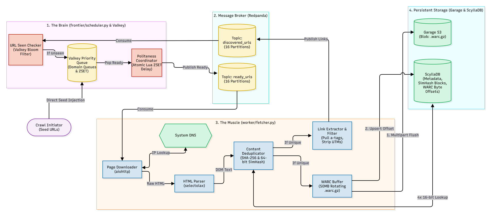

# Distributed Web Crawler Pipeline

An asynchronous, highly concurrent web crawler built with a decoupled microservices architecture. Designed from first principles to handle URL scheduling, near-duplicate detection, and WARC archiving entirely locally within strict hardware constraints (an 8GB RAM memory ceiling).


##  Architecture

The system utilizes a 100% open-source, low-memory tech stack to replicate enterprise cloud patterns locally:  

*  **The Brain (Scheduler):** Python `asyncio` worker that pulls discovered links, filters them through a **Valkey Bloom Filter**, and handles domain-politeness scheduling.

*  **The Muscle (Fetcher):** Python `asyncio` workers that consume ready URLs, stream HTML, parse DOMs via a C-backed library (`selectolax`), and write WARC archives.

*  **Message Broker (Redpanda):** A lightweight C++ Kafka-compatible broker decoupling the scheduling and fetching phases without JVM overhead.

*  **State & Queues (Valkey):** A Redis fork managing the deduplication Bloom filter and atomic Lua ZSETs to prevent Head-of-Line blocking.

*  **Metadata & Indexing (ScyllaDB):** A C++ Cassandra-compatible database tuned to 512MB RAM, storing $O(1)$ near-duplicate SimHash indexes.

*  **Object Storage (Garage):** A lightweight Rust-based S3 alternative storing the compressed `.warc.gz` chunked archives.


## System Flow Diagram



##  Key Engineering Highlights

*  **Hardware-Constrained C++ Database Tuning:** Configured ScyllaDB's Seastar engine to operate strictly within a 512MB RAM ceiling (`--memory 512M`), allowing an enterprise-grade distributed database to run smoothly alongside worker containers on an 8GB machine.

*  **$O(1)$ Near-Duplicate Detection:** Implemented a 64-bit SimHash algorithm mapped to ScyllaDB using the Pigeonhole Principle (4x 16-bit chunks). This allows the crawler to detect and skip near-duplicate web pages (Hamming distance $\le  3$) via four $O(1)$ index lookups instead of scanning the entire database.

*  **Anti-Head-of-Line Blocking:** Built an atomic Valkey Lua script that acts as a politeness coordinator. It utilizes Sorted Sets (ZSET) governed by timestamps to ensure slow or rate-limited domains never block fast domains in the Kafka message queues.

*  **Zero-Network-Overhead Archiving:** Fetchers buffer HTML payloads into local rotating chunks, sealing and uploading them to S3 object storage only when they hit a 50MB threshold. This batching strategy prevents object storage fragmentation and minimizes PUT-request costs.

*  **Random-Access Payload Retrieval:** Indexed S3 byte-offsets and payload lengths directly into ScyllaDB, enabling HTTP Range requests for instant random-access payload retrieval without unzipping full archives.

  

##  Local Setup & Execution

### Prerequisites

* Docker and Docker Compose

* Python 3.10+

*  `pip` and `virtualenv`

  

### 1. Start the Infrastructure

Spin up the local microservices (Redpanda, ScyllaDB, Valkey, Garage).

```bash
docker  compose  up  -d
```

### 2. Initialize the Database Schema

Load the metadata and SimHash tables into ScyllaDB.

```bash
docker  compose  exec  cassandra  cqlsh  -f  /schema.cql
```
### 3. Initialize Message Queues (Redpanda)

Pre-create the decoupled Kafka topics with 16 partitions to support horizontal worker scaling.

```bash
docker compose exec kafka rpk topic create ready_urls discovered_urls -p 16  
```

### 4. Setup Python Environment & Credentials

Install the required asynchronous dependencies.

```bash
python3  -m  venv  .venv
source  .venv/bin/activate
pip  install  -r  requirements.txt
```

Create a .env file in the project root with your Garage access keys.

```env
GARAGE_ACCESS_KEY_ID=your_garage_access_key
GARAGE_SECRET_ACCESS_KEY=your_garage_secret_key
```

### 5. Launch the Crawler

Because the system is decoupled via Kafka, you must run the Worker (Muscle) and the Scheduler (Brain) in separate terminal sessions.

**Terminal 1 (The Worker):**
```bash
source  .venv/bin/activate
PYTHONPATH=.  python  worker/fetcher.py
```
**Terminal 2 (The Scheduler):**
```bash
source  .venv/bin/activate
PYTHONPATH=.  python  frontier/scheduler.py
```
*Note: The worker buffers files locally and uploads to Garage S3 only after reaching the 50MB batch limit. You can monitor the uploaded `.warc.gz` chunks in the Garage Web UI at `http://localhost:3909`.*
